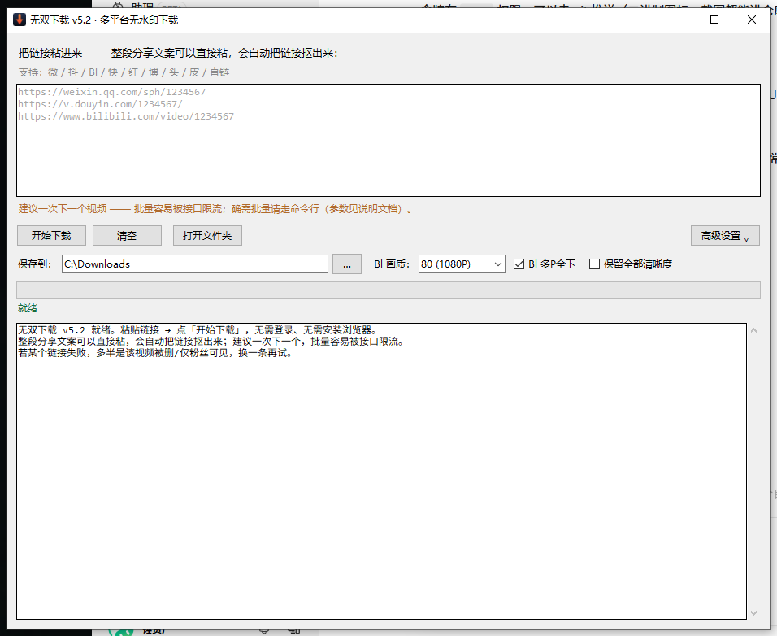

# 短视频无水印下载 · Skill

> 一个自带可执行代码的 AI Agent 技能：把**分享链接**变成**可下载的真实视频文件地址**，然后用 Python 标准库直接下载。
> **无需浏览器、无需登录、无需装证书、无需改系统代理、零第三方依赖。**

**开发者**：锤无双 ｜ **B站主页**：https://space.bilibili.com/20422065

---

## 这是什么

大部分「短视频下载」工具的做法是**浏览器嗅探**或**代理抓包**：装根证书、改系统代理、开管理员权限、盯着浏览器窗口。这套技能走的是另一条路 —— **一次 HTTP 请求调公开解析接口拿直链，再用标准库下载**。

好处很直接：不弹窗、不登录、不吃内存、可以在服务器上跑，也能被 AI Agent 直接调用。

它同时也是一个完整可运行的程序：`scripts/wushuang_dl.py`，825 行，纯标准库。给 AI 用是技能，给人用是命令行工具。

## 支持平台

| 代号 | 平台 | 下载时 Referer |
|---|---|---|
| 微 | 视频号 | `https://channels.weixin.qq.com/` |
| 抖 | 抖音 | `https://www.douyin.com/` |
| Bl | B站 | 走官方 API，支持选画质 / 多 P |
| 快 | 快手 | `https://www.kuaishou.com/` |
| 红 | 小红书 | `https://www.xiaohongshu.com/`（图文笔记会下图片） |
| 博 | 微博 | `https://weibo.com/` |
| 头 | 头条 | `https://www.toutiao.com/` |
| 皮 | 皮皮虾 | `https://www.pipixia.com/` |
| 直链 | `.mp4` / `.m3u8` | 直接下载 |

## 安装

```bash
git clone https://github.com/chuiziyao/wushuang-download-skill.git \
  ~/.workbuddy/skills/短视频无水印下载
```

或下载 ZIP 解压到平台的 `skills/` 目录（目录名保持 `短视频无水印下载`）。详见 [安装指南.md](安装指南.md)。

**环境要求**：Python 3.9+，**零第三方依赖**。

## 用法

### 命令行直接跑

```bash
SK=~/.workbuddy/skills/短视频无水印下载/scripts/wushuang_dl.py

# 单条下载
python "$SK" "https://v.douyin.com/xxxxxx/" -o ./out

# 整段分享文案直接粘（自动抠链接，不用手动删字）
python "$SK" "7.12 复制打开抖音… https://v.douyin.com/xxxxxx/ :1pm" -o ./out

# B站：选画质 / 只下第 1 个分 P / 列出全部清晰度
python "$SK" "https://www.bilibili.com/video/BVxxxxxxxxxx" -q 116 -o ./out
python "$SK" "https://www.bilibili.com/video/BVxxxxxxxxxx" --first-part -o ./out
python "$SK" "https://www.bilibili.com/video/BVxxxxxxxxxx" --all-quality -o ./out

# 接口挂了时换源（| 分隔，前一个失败自动切下一个）
python "$SK" "链接" -o ./out \
  --api "https://新域名/api/{name}?url={url}|https://备用域名/api/{name}?url={url}"
```

| 参数 | 作用 |
|---|---|
| `-o` / `--out` | 保存目录，不存在自动创建 |
| `-q` / `--quality` | B站画质：120=4K / 116=1080P60 / 80=1080P / 64=720P / 32=480P |
| `--first-part` | B站只下第 1 个分 P |
| `--all-quality` | B站列出所有可用清晰度 |
| `--api` | 临时指定解析源，`\|` 分隔，支持多源容错 |

不带参数运行则启动图形界面（需要 `tkinter`）。

### 给 AI Agent 用

装上技能后，直接说「把这个视频存下来」并粘链接即可。技能里写明了完整的调用方式、校验方式与踩坑记录。

## 原理

```
分享链接（加密页面地址）
    ↓  ① 交给解析接口换票： GET /api/{name}?url=<编码后的分享链接>
真实直链（带签名的 MP4，几十分钟到 24 小时过期）
    ↓  ② Python 标准库 urllib 直接下载（视频数据从平台服务器直达本机，不经过接口方）
本地文件
    ↓  ③ 校验文件头（ftyp / FLV / PNG…）确认真的是媒体文件
```

视频数据**不经过接口方**，接口只负责递一张票。

## 一条必须遵守的原则：下载后校验文件头

**不要以「文件生成成功」作为完成判据** —— 直链过期时照样会生成文件，只是内容是网页。

```bash
python -c "
import glob, os
for f in sorted(glob.glob('out/*')):
    h = open(f,'rb').read(12)
    ok = h[4:8]==b'ftyp' or h[:3]==b'FLV' or h[:4]==b'\x1aE\xdf\xa3'
    print(('MP4 ✅' if ok else '坏文件 ❌'), os.path.getsize(f)//1024, 'KB', os.path.basename(f))"
```

判定速查：mp4 `h[4:8]==b'ftyp'`｜mkv `\x1aE\xdf\xa3`｜flv `FLV`｜jpg `\xff\xd8\xff`｜png `\x89PNG`。
**头是 `<` / `{` / `\xef` → 下到的是网页或 JSON，直链已过期或需鉴权。**

## 关于接口失效（重要）

通用平台走的是**公开公益接口**，没有服务承诺，随时可能关停或换域名。技能里内置了多源容错与替换办法：

```
https://api.bugpk.com/api/{name}?url={url}|https://你的备用源/api/{name}?url={url}
```

`|` 分隔按序尝试，前一个失败自动切下一个。

**接口挂了怎么办**：搜索「短视频解析 免费接口」，挑一个能用的，**只换域名**，`{name}` 和 `{url}` 两个占位符照抄填回去。

B站不依赖这个接口 —— 走的是官方 `api.bilibili.com`，因此**是全部平台里最稳的一条**。

## 图形界面版

本技能是 [无双下载](https://github.com/chuiziyao/wushuang-download) 图形界面版的命令行内核 —— 同一套解析逻辑。需要给非技术用户用时，直接给那个仓库的 Release 单文件 exe（约 12 MB，双击即用）。



## 文档

技能内部（[SKILL.md](SKILL.md)）记录了完整的技术细节，包括：

- 接口返回结构、`expire_time` 时效、Referer 策略
- B站 412 风控的完整请求头要求
- **开源项目调研结论**（2026-10 实测 `yt-dlp` / `res-downloader` / `ltaoo/wx_channels_download` 等 7 个项目的真实可用性）
- **为什么别的路走不通**（抖音网页端、视频号网页端、CDP 自动化的实测失败原因）
- 打包、图标生成、PE 资源解析、GUI 自检、成品 exe 自检的实现要点与踩坑

## 免责声明

本技能仅用于下载**你自己发布的**、或**已获得明确授权**的内容。

搬运、二次剪辑他人作品违反平台规则，也可能侵犯著作权。本技能不提供任何绕过平台授权机制的能力 —— 它依赖的是公开可访问的解析接口，不涉及破解、不涉及账号登录、不涉及证书劫持。

使用本技能产生的一切后果由使用者自行承担。

## License

[MIT](LICENSE) © 2026 锤无双
